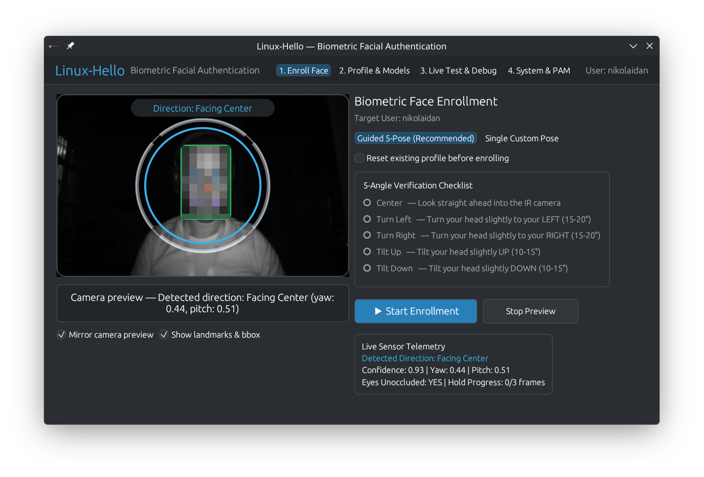

<p align="center">
  
</p>

<p align="center">
  <a href="https://github.com/kennycoder/linux-hello/actions/workflows/ci.yml"></a>
  <a href="https://github.com/kennycoder/linux-hello/actions/workflows/release.yml"></a>
  <a href="https://github.com/kennycoder/linux-hello/releases"></a>
  <a href="LICENSE"></a>
</p>

# Linux-Hello

A high-performance, secure biometric facial authentication system for Linux, designed as a fast, native equivalent to **Windows Hello**.

Built in **Rust** with C++ OpenCV DNN acceleration, leveraging dedicated Infrared (IR) cameras, ONNX face detection & recognition models, a standalone cross-desktop GUI (`linux-hello-gui`), and native PAM integration.

<p align="center">
  
</p>

---

## Installation

Precompiled packages are available on [GitHub Releases](https://github.com/kennycoder/linux-hello/releases).

### Debian / Ubuntu
```bash
# APT repository (auto-updates):
curl -fsSL https://kennycoder.github.io/linux-hello/linux-hello.gpg | sudo tee /usr/share/keyrings/linux-hello.gpg >/dev/null
echo "deb [arch=amd64 signed-by=/usr/share/keyrings/linux-hello.gpg] https://kennycoder.github.io/linux-hello/ stable main" | sudo tee /etc/apt/sources.list.d/linux-hello.list
sudo apt update && sudo apt install linux-hello

# Or direct .deb install:
sudo apt install ./linux-hello_*_amd64.deb
```

### Fedora
```bash
sudo dnf install ./linux-hello-*.x86_64.rpm
```

### Arch Linux
```bash
sudo pacman -U ./linux-hello-*-x86_64.pkg.tar.zst
```

### Build from Source
```bash
make
sudo make install
```

---

## Quick Start

```bash
# 1. Start the service
sudo systemctl enable --now linux-hello.service

# 2. Enroll your face
linux-hello-gui   # or: sudo linux-hello-cli add

# 3. Enable PAM authentication
sudo linux-hello enable              # System-wide (login + sudo)
# Or: sudo linux-hello enable --sudo-only   # Sudo only
```

---

## Configuration & PAM Details

### 1. System-Wide vs Sudo-Only Mode
- **System-Wide (`sudo linux-hello enable`)**:
  - **Debian / Ubuntu**: Uses `pam-auth-update`
  - **Fedora / RHEL**: Uses `authselect`
  - **Arch Linux**: Automatically and safely edits `/etc/pam.d/system-auth`
- **Sudo-Only (`sudo linux-hello enable --sudo-only`)**:
  - Restricts facial authentication to `sudo` via `/etc/sudoers.d/`, leaving lockscreen and login untouched.

   ```text
   @include common-auth
   @include common-account
   @include common-session-noninteractive
   ```

3. **Point `sudo` to the custom PAM service via `/etc/sudoers.d/`**:
   Create a drop-in configuration in `/etc/sudoers.d/` (using `visudo` to validate syntax and set `0440` permissions):
   ```bash
   sudo visudo -f /etc/sudoers.d/custom_etc_sudoers_d
   ```
   Add the following line:
   ```text
   Defaults pam_service="sudo-hello"
   ```

---

## Verification & Safe Testing

1. Make sure you have enrolled your face first (`linux-hello-gui` or `sudo linux-hello add`).
2. Open a separate terminal window and keep a root shell open (`sudo -s`) as a safeguard.
3. In another terminal, run:
   ```bash
   sudo whoami
   ```
   The camera will illuminate and authenticate your face without requiring a password.
4. **Password Fallback**: Cover the IR camera with your hand or a card and run `sudo whoami`. The system will seamlessly fall back to the standard password prompt without hanging.

---

## Features

- **Standalone Cross-Desktop GUI (`linux-hello-gui`)**:
  - Works natively across all Linux desktop environments and window managers (KDE Plasma, GNOME, XFCE, Hyprland, Sway, i3) with zero toolkit bloat.
  - **Live IR Camera Viewfinder**: Real-time 60 FPS grayscale IR feed, YuNet bounding box & 5-point landmark overlays, and Windows Hello-style circular 5-pose ring.
  - **Profile & Template Management**: Inspect 5-angle coverage, remove individual pose templates, or reset your biometric profile.
  - **Live Recognition Debugger**: Real-time cosine similarity gauge, per-pose template breakdown, eye-occlusion telemetry, and one-click daemon socket testing.
  - **One-Click System & PAM Control**: Toggle Sudo-Only or System-Wide PAM authentication and manage `linux-hello.service` via native Polkit (`pkexec`) privilege elevation.
- **Native KDE Plasma System Settings Module (`kcm_linuxhello`)**:
  - Native KDE Control Module (KCM) built with Qt 6, KDE Frameworks 6 (KF6), and Kirigami FormCards.
  - Located under **Security & Privacy** in KDE Plasma System Settings.
  - Displays at-a-glance system status (daemon active/stopped, camera hardware detection, PAM integration mode, enrolled user accounts).
  - Provides instant access to trigger the Linux Hello Manager or start the daemon service.
- **Dedicated IR Camera Support**:
  - Direct Linux V4L2 `mmap` streaming on `/dev/video{n}` (usually 2, but it also auto-detects IR camera).
  - Automatically filters illuminated infrared strobe frames from ambient/dark frames.
  - **Hardware Safeguard**: Strictly verifies dedicated IR camera capabilities (via `GREY`, `Y16`, `Z16` formats or IR device card metadata). Never defaults to a standard RGB webcam (`/dev/video0`) to prevent insecure fallback.
- **Modern Face Biometrics**: Powered by OpenCV Zoo ONNX models:
  - **YuNet**: Ultra-fast face and 5-point facial landmark detector running at high confidence ($\ge 0.70$).
  - **SFace**: Canonical 112×112 face alignment and 128-dimensional hyperspherical feature embedding extractor with Cosine distance matching.
- **Anti-Spoofing & Anatomical Landmark Validation**:
  - Eliminates false positives from non-face textures, fabric folds, cushions, or arbitrary objects.
  - Validates human anatomical geometry: inter-ocular eye distance ($\ge 18\text{px}$), mouth below eye line ($\ge 8\text{px}$), nose tip vertically positioned between eyes and mouth, bounding box bounds ($\ge 45\times 45\text{px}$), and human facial aspect ratios ($0.45 \le AR \le 1.60$).
  - Strict cosine similarity matching threshold of **0.65** (real, unoccluded faces score $0.70 - 0.90+$, occlusions, covered eyes/features, non-matching faces and noise score $< 0.60$).
- **Interactive Multi-Angle Enrollment**:
  - Guided 5-pose registration state machine: **Center**, **Turn Left** (15-20°), **Turn Right** (15-20°), **Tilt Up** (10-15°), and **Tilt Down** (10-15°).
  - Live horizontal (`yaw`) and vertical (`pitch`) pose estimation with real-time on-screen guidance (e.g. `➔ Turn more to your LEFT`).
  - **3-Frame Steady Hold Requirement**: Verifies that the user holds the target pose steadily before capturing.
- **Client-Daemon Architecture (like `fprintd`)**:
  - `linux-hellod`: Background system daemon keeping models warm in memory for instant sub-100ms verification.
  - `pam_linux_hello.so`: Ultra-lightweight (517 KB) PAM module with zero heavy runtime dependencies in PAM process space.
  - Fail-safe fallback: If camera or daemon is offline, PAM immediately and seamlessly falls back to password authentication without hanging.
- **CLI Goodies**: Complete management tool for enrollment, testing, camera diagnostics, offline image analysis, and service control.

---

## Architecture Overview

```
                 +---------------------------+
                 |  Login / Sudo / GDM / PAM |
                 +-------------+-------------+
                               | (C ABI)
                 +-------------v-------------+
                 |    pam_linux_hello.so     |
                 +-------------+-------------+
                               | Unix Socket (/run/linux-hello.sock)
+-------------+  +-------------v-------------+  +-----------------+
| linux-hello |->|       linux-hellod        |<-| linux-hello-gui |
|     CLI     |  +-------------+-------------+  |  (Desktop App)  |
+-------------+                |                +-----------------+
                 +-------------+-------------+
                 |   V4L2 IR Stream Capture  |
                 |      (/dev/video2)        |
                 +-------------+-------------+
                               |
                 +-------------v-------------+
                 |     YuNet Face Detector   |
                 |   (Anatomical Validation) |
                 +-------------+-------------+
                               | (5-point alignment)
                 +-------------v-------------+
                 |      SFace Recognizer     |
                 |      (128-D Embedding)    |
                 +-------------+-------------+
                               |
                 +-------------v-------------+
                 |   Cosine Similarity (0.65)|
                 |  vs Enrolled Vector DB    |
                 +---------------------------+
```

---

## Directory Structure

```text
linux-hello/
├── crates/
│   ├── linux-hello-camera/    # Direct V4L2 ioctl streaming & IR camera discovery
│   ├── linux-hello-core/      # OpenCV YuNet + SFace C++ bridge & Rust safe API
│   ├── linux-hellod/          # Background daemon service & Unix socket IPC
│   ├── pam_linux_hello/       # Native PAM module (.so) with password fallback
│   ├── linux-hello-cli/       # CLI utility (linux-hello)
│   └── linux-hello-gui/       # Standalone GUI application (linux-hello-gui)
├── kde-kcm/                   # KDE Plasma 6 System Settings Control Module (KCM)
├── packaging/
│   ├── arch/                  # Arch Linux PKGBUILD & post-install hooks
│   └── fedora/                # Fedora / RHEL RPM spec file (linux-hello.spec)
├── debian/
│   ├── control, postinst...   # Debian package control & maintainer scripts
│   ├── linux-hello.service    # Systemd service unit
│   ├── linux-hello-gui.desktop# Freedesktop application launcher
│   ├── org.linuxhello.pkexec.policy # Polkit administrative policy
│   └── pam-config             # pam-auth-update integration profile
├── models/
│   ├── face_detection_yunet.onnx
│   └── face_recognition_sface.onnx
├── assets/                    # Logos, icons, and UI screenshots
├── Makefile                   # Build, test, and multi-distro installation rules
└── README.md
```

---

## Prerequisites & Build Dependencies

When building from source, `linux-hello-core` compiles a C++17 bridge against **OpenCV 4** (`opencv_core`, `opencv_dnn`, `opencv_objdetect`, `opencv_imgproc`) to accelerate YuNet (`cv::FaceDetectorYN`) and SFace (`cv::FaceRecognizerSF`) ONNX inference.

### Core Build Dependencies

Install the required system dependencies for your distribution:

- **Debian / Ubuntu**:
  ```bash
  sudo apt update
  sudo apt install build-essential libopencv-dev libpam0g-dev
  ```
- **RHEL / Fedora / Rocky / AlmaLinux**:
  ```bash
  sudo dnf install gcc-c++ make opencv-devel pam-devel
  ```
- **Arch Linux**:
  ```bash
  sudo pacman -S --needed base-devel opencv pam
  ```

### KDE Plasma 6 Control Module (`kcm_linuxhello`) Dependencies (Optional)

To build the native KDE Plasma 6 System Settings module (`kde-kcm`), install the **CMake**, **ECM**, **Qt 6** (`Core`, `Quick`, `Network`), and **KDE Frameworks 6** (`CoreAddons`, `KCMUtils`, `I18n`) development packages (along with the runtime Kirigami FormCard QML module):

- **Debian (13+) / Ubuntu (24.10+ / 26.04+)**:
  ```bash
  sudo apt install cmake extra-cmake-modules qt6-base-dev qt6-declarative-dev libkf6coreaddons-dev libkf6kcmutils-dev libkf6i18n-dev qml6-module-org-kde-kirigamiaddons-formcard
  ```
- **Fedora / RHEL**:
  ```bash
  sudo dnf install cmake extra-cmake-modules qt6-qtbase-devel qt6-qtdeclarative-devel kf6-kcoreaddons-devel kf6-kcmutils-devel kf6-ki18n-devel kf6-kirigami-addons
  ```
- **Arch Linux**:
  ```bash
  sudo pacman -S --needed cmake extra-cmake-modules qt6-base qt6-declarative kcoreaddons kcmutils ki18n kirigami-addons
  ```

*(If these packages are not installed, `make` will print `"KDE build dependencies (ECM / KF6 / Qt6) not fully present; skipping KCM build."` and continue building the core daemon, CLI, standalone GUI, and PAM module.)*

### Rust Toolchain

You also need a **Rust toolchain** (Rust 1.85+ for the 2024 edition, via [rustup.rs](https://rustup.rs/) or your system package manager). Verify core build prerequisites at any time with:

```bash
make check-deps
```

---

## Quick Start

### 1. Build
```bash
make
```
*(To clean build artifacts at any time, run `make clean`.)*

### 2. Launch the Graphical Application (`linux-hello-gui`)
```bash
./target/release/linux-hello-gui
# Or after installation:
linux-hello gui
```

### 3. Inspect Connected Cameras
```bash
./target/release/linux-hello cameras
```
Output:
```text
Detecting connected video devices...

Device: "/dev/video2" [IR CAMERA]
  Card:    ASUS FHD webcam: ASUS IR camera
  Driver:  uvcvideo
  Formats: GREY
```

### 4. Take a Snapshot from the IR Camera
```bash
./target/release/linux-hello snapshot --output test_ir.png
```

### 5. Enroll Your Face (Guided Multi-Angle)
Position yourself in front of the IR camera and run:
```bash
sudo ./target/release/linux-hello add
```

*(Optional flags)*:
- `-r`, `--replace`: Clear any existing models for the user before enrolling.
- `--user <name>`: Enroll for a specific user account.
- `--device /dev/videoX`: Specify a custom camera device node.
- `[LABEL]`: Enroll a single custom template (e.g. `linux-hello add glasses`).

### 6. List Enrolled Profiles
```bash
sudo ./target/release/linux-hello list
```

### 7. Test Live Recognition
```bash
./target/release/linux-hello test
```

---

## Standalone Testing & Debugging (No System Integration Required)

You can thoroughly test and debug face detection, pose estimation, and face recognition models directly without running the daemon, without PAM, and without root:

### 1. Live Camera Stream Debugger (`debug`)
Inspect incoming camera frames, face detection confidence, bounding boxes, 5 facial landmarks, estimated head pose, and cosine similarity scores in real time:
```bash
# Debug face detection and head pose live from camera (30 seconds):
./target/release/linux-hello debug

# Debug matching in real time against your enrolled profile:
./target/release/linux-hello debug --user $USER

# Run indefinitely until Ctrl+C:
./target/release/linux-hello debug --duration 0
```
Live output example:
```text
[0042] Bright: 38.2 | Conf: 0.94 Box: [220,140,150,190] | Pose: yaw=0.51 pitch=0.54 (Facing Center) (32.1ms) | MATCH: 0.742 ('center')
```

### 2. Offline Image Face Inspection (`debug --image`)
Analyze any image file (PNG) to inspect detected faces, bounding boxes, landmarks, confidence, and pose estimation:
```bash
./target/release/linux-hello debug --image test_ir.png
```
Output:
```text
=======================================================
           Linux-Hello Face Debugger (Image)           
=======================================================
Image file:  "test_ir.png"
Dimensions:  640x400
Inference:   36.94ms | Faces detected: 1

[Face #1]
  Confidence:  0.93
  BoundingBox: [x: 223.7, y: 147.5, w: 148.9, h: 191.3]
  Pose Ratios: yaw: 0.51, pitch: 0.55 (Facing Center)
  Landmarks:   R-Eye (267.1,218.1) | L-Eye (333.5,218.5) | Nose (300.9,254.1)
=======================================================
```

### 3. Compare Two Face Images (`compare`)
Completely offline, 1-to-1 facial verification between any two PNG images:
```bash
./target/release/linux-hello compare photo1.png photo2.png
```
Prints face bounding boxes, poses, detection scores for both images, and the exact cosine similarity distance (e.g. `0.785 >= 0.500` -> `[MATCH SUCCESS]`).

### 4. Test an Image Against Enrolled Templates (`identify`)
Identify whether an offline image matches an enrolled user profile:
```bash
./target/release/linux-hello identify photo.png --user $USER
```
Displays individual similarity scores for all enrolled head angles (Center, Left, Right, Up, Down).

### 5. Direct Authentication Test (`test --direct`)
Authenticate directly against camera hardware and local profile storage, completely bypassing the system daemon (`linux-hellod`) and socket:
```bash
./target/release/linux-hello test --direct
```

